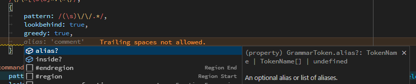

# Current state of v2

Summary:

- Everything is now TypeScript and ESM.
- There is now a `Prism` class and a global/default instance of it.
- Languages and plugins are added to a registry and lazily loaded.
- ESM now handles language (require) dependencies. Optional dependencies are handled by the registry.
- All languages and plugins are fully migrated to the new system. All tests pass.
- Themes are unchanged.
- The build process is half-finished.
- The website is unfinished (download page doesn't work).

## TypeScript

Everything is now TypeScript. Languages, plugins, tests, etc.

The main reason for this was a technical limitation in the way Node.js supports ESM. ESM is explicitly opt-in via `type: module` in `package.json`. Note that this doesn't just _enable_ ESM, it also _disables_ running CommonJS code. Porting our scripts to ESM was easy, tests were very hard, danger seemed impossible.

TypeScript was the easy way out. TS uses ESM by default, and just transpiles it down to CommonJS when necessary. This made it trivial to port the entire codebase to ESM, since Node.js no longer got in the way.

Of course, I also wanted TS for other reasons:

- JSDoc is a pain. It's excessively verbose to declare interfaces, type aliases, and argument/return types. Some features are missing (e.g. type imports, extending interfaces) and it lacks basic tooling (e.g. formatting).
- Trivial to generate type definitions. HighlightJS went the JSDoc route, and they seem to maintain a separate type definition file to this day. AFAIK, there is no commonly-used tool to generate type definitions from JSDoc, and I don't want to maintain code and types for said code separately.
- Useful code completing for languages.
  

## Prism class and global instance

There is now a `Prism` class and a global/default instance of it. This makes it trivial to construct Prism instances for tests, while users can just use the global instance like before. Of course, advanced users can also create their own instances.

The main motivation for this is twofold:

1. Typing. Having a class and then passing around instances of it is a lot easier to annotate than passing around a specific global object.
2. Testing. We need to construct many different Prism instances to run our tests. This was previously done by hackily importing Prism in different configurations over and over again. Now testing is a lot easier.

## Lazy immutable grammars

Grammars are now lazily constructed on usage. This means that users no longer have to pay for Prism blocking the main thread while it creates thousands of regexes. It's also necessary for optional dependencies. More on that later.

Grammars are now (assumed to be) immutable. This is necessary for correctness. Since other languages/plugins may make assumptions about the tokens/regexes in a specific grammar, outside modifications could break those languages/plugins.

(Users are still free to modify grammars (immutability is not enforced), but they should be aware of the potential consequences.)

## ESM and a new language registry

We now use ESM for language dependencies. E.g. the TypeScript language definition now includes a `import javascript from './prism-javascript';`. This means that we (and our users) no longer need any special handling for language dependencies, and can simply import languages as normal ESM modules.

However, one feature we need (but ESM doesn't support) are optional dependencies. (Dynamic `import(url)` isn't an option for us.) Optional imports are now resolved at runtime by a new language registry.

## Optional dependencies

Optional dependencies are resolves at runtime in 2 main ways:

1. Grammar references: `inside` now support a string to reference another grammar. E.g. `inside: 'javascript'` will use the `javascript` grammar if available.

   This little trick eliminates the need to handle optional dependencies at all. Since the grammar is resolved at runtime like any other language, no special handling is necessary.

2. Language registry: Languages and plugins can explicitly define optional dependencies. E.g. CSS declares `optional: 'css-extras'` to optionally depend on CSS Extras.

   Since languages are lazily constructed, the order in which languages are registered doesn't matter. This largely solves the order problem of optional dependencies. The problem of optional dependencies being added _after_ a language has already been constructed is solved by simply removing the language from an internal cache and re-constructing it the next time it's needed.

   While I explained this using languages, plugins work the same way.

## Plugins and the effect system

Plugins are separated into 2 parts: the plugin API and the plugin effect.

- API: The plugin API is an object under the `Prism.plugins` namespace (e.g. `Prism.plugins.normalizeWhitespace`) and contains the configurations of the plugin. It's what users interact with.
- Effect: The plugin effects are things like hooks. They are the actual implementation of the plugin.

The reason those 2 parts are separated is twofold:

1. Effects often require the DOM. By making the effects of a plugin separate from its API, plugins can be configured and interacted with in user-code without requiring the DOM. This means that all plugins are usable in Node.js and the browser.
2. Effects can be undone. Just like optional dependencies might require languages to be reloaded, plugins might also reload. Effects are explicitly designed to be undoable to support optional dependencies. However, reloading the plugin's API would reset its configuration, so effects and API need to be separate.

## The build process

It's functional and currently generates a structure like this:

<details>

```
dist/
├───esm/
│   │   core.js
│   │   shared.js
│   │
│   ├───languages
│   │       prism-abap.js
│   │       prism-abnf.js
│   │       prism-actionscript.js
│   │       ...
│   │
│   ├───plugins
│   │       prism-autolinker.js
│   │       prism-autoloader.js
│   │       prism-command-line.js
│   │       ...
│
├───cjs/
│   | same as esm/
│
├───plugins/
│       prism-autolinker.css
│       prism-command-line.css
│       ...
│
└───themes/
        prism.css
        prism-coy.css
        ...
```

</details>

`core.js` is the core library, and `shared.js` contains shared functionality for plugins (first- and third-party). Both are part of the public API.

What's still missing:

- Exports for the global Prism instance. `core.js` only contains the `Prism` _class_.
- Exports for `auto-start.js`. This file takes the global Prism instance + AutoLoader and uses them to automatically highlight all code once the page is loaded.

## The website

I haven't touched the website at all, so nothing works. See https://github.com/PrismJS/prism/issues/3550

# The path ahead

The main challenges that still need to be solved are:

1. The build process. We need to think about which bundles we want to provide to users.
2. The website. The main problem here is the download page. We essentially need rollup to generate bundles, but I'm not sure whether rollup even supports this.
